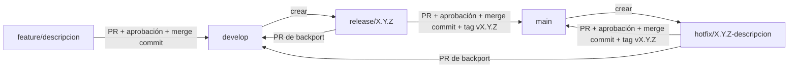
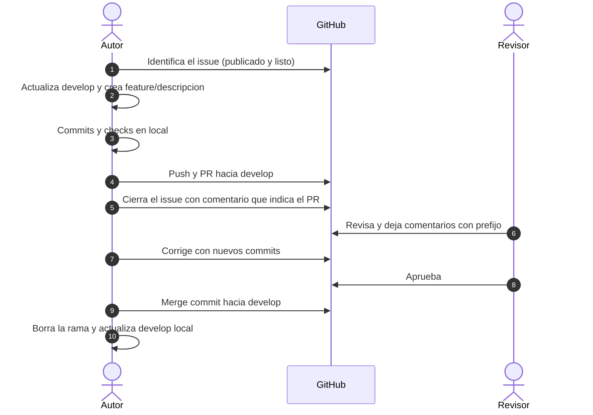
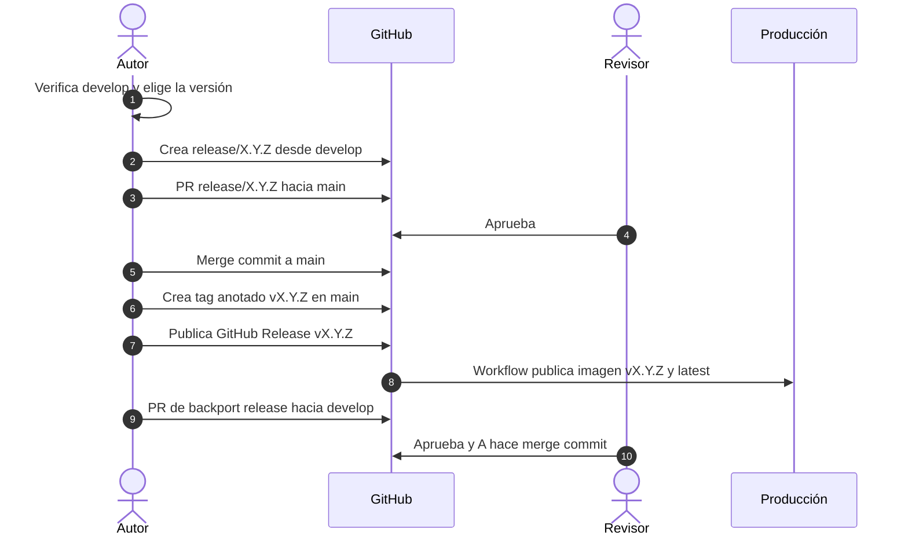
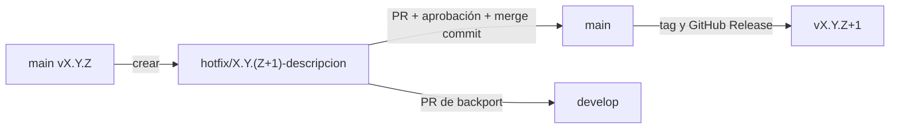

# Flujo de trabajo con Git

Cómo se cambia código: desde el issue hasta `develop`, cómo sale una versión a `main` y cómo se corrige producción. Aplica a todos los proyectos del equipo.

> [!info] Fuente única
> Este documento reemplaza a `Flujos de trabajo con git.md` (raíz del vault). Si algo aquí contradice otra nota, manda esta. Los criterios de "listo" están en [[04.01 Definition of Ready (DoD & DoR)]].

## Mapa de ramas



| Rama                         | Desde     | Hacia                    | Para qué                                                              |
| :--------------------------- | :-------- | :----------------------- | :-------------------------------------------------------------------- |
| `main`                       | —         | —                        | Código en producción. Cada commit de `main` es un merge con tag.      |
| `develop`                    | `main`    | —                        | Integración. Lo que llegó aquí está listo para la siguiente versión.  |
| `feature/<descripcion>`      | `develop` | `develop`                | Una funcionalidad o cambio. Vive días, no semanas.                    |
| `release/X.Y.Z`              | `develop` | `main`                   | Preparar una versión. Solo correcciones menores y ajustes de versión. |
| `hotfix/X.Y.Z-<descripcion>` | `main`    | `main` y luego `develop` | Corrección urgente en producción.                                     |

Ejemplos: `feature/login-google`, `release/0.2.0`, `hotfix/0.1.6-error-pago`.

> [!tip] ¿Qué rama creo?
>
> ```mermaid
> flowchart TD
>   A{¿Qué necesitas?} -->|Funcionalidad o cambio| B["feature/... desde develop"]
>   A -->|Preparar una versión| C["release/X.Y.Z desde develop"]
>   A -->|Arreglo urgente en producción| D["hotfix/X.Y.Z-descripcion desde main"]
> ```

## Reglas

> [!important] Las reglas se cumplen por acuerdo
> El plan de GitHub del equipo no protege ramas en repositorios privados. Nadie tiene el control técnico para impedir un push directo: la regla depende de todos.

1. **No hay push directo a `main` ni a `develop`.** Todo cambio entra por pull request (PR).
2. **Un PR a `develop` requiere al menos 1 aprobación de otra persona.**
3. **Un PR a `main` requiere al menos 1 aprobación de otra persona.**
4. **Nadie aprueba su propio PR.**
5. **Las ramas `feature/` se crean siempre desde `develop`.**
6. **Solo se abre un PR a `main` desde `release/` o `hotfix/`.**
7. **Los merges a `develop` y a `main` son commits de merge.** No se usa _squash_ ni _rebase_ para integrar.
8. **Cada merge a `main` lleva un tag anotado `vX.Y.Z` sobre el commit de merge.**
9. **Cada hotfix se integra también en `develop` por PR**, para que la corrección no se pierda en la siguiente versión.
10. **El autor resuelve sus conflictos antes de pedir revisión.** Puede actualizar su rama con `develop` por _merge_ o _rebase_, pero nunca reescribe el historial de `main` ni de `develop`.

Además aplica la Definition of Done de [[04.01 Definition of Ready (DoD & DoR)]]: PR menor de 500 líneas, documentación actualizada en el mismo PR y captura si cambia la interfaz.

## Paso a paso: cambiar código

Este es el ciclo que se repite por cada issue.



### 1. Identificar el issue

- [ ] El issue existe en GitHub y está listo según [[04.01 Definition of Ready (DoD & DoR)]].
- [ ] Sabes en qué repo vive el cambio.

```bash
gh issue list --repo <organizacion>/<repo>
gh issue view 62
```

> [!warning] Sin issue no hay trabajo
> Si el cambio no tiene issue, se crea primero. Lo que no está en GitHub no existe para el equipo.

### 2. Actualizar `develop` local

```bash
git fetch origin
git switch develop
git pull --ff-only origin develop
```

`--ff-only` evita crear un merge accidental en tu `develop` local. Si falla, algo local está mal: no lo forces, pregunta.

### 3. Crear la rama de trabajo

```bash
git switch -c feature/<descripcion>
```

- Minúsculas, palabras separadas por guiones, 2 a 4 palabras: `feature/perfil-cuenta`.
- El número del issue no va en el nombre: va en el PR y en el commit.

### 4. Hacer los commits

Commits pequeños, un cambio por commit, en [[#Commits|Conventional Commits]]:

```bash
git add -p
git commit -m "feat(auth): agregar cambio de contraseña" -m "Refs #62"
```

Cuando el cambio toca comportamiento, la prueba y la documentación van en el mismo PR.

### 5. Checks en local

| Repo     | Comando                        | Cuándo además                                      |
| :------- | :----------------------------- | :------------------------------------------------- |
| Backend  | `make check`                   | `make test-integration` si toca API, BD o permisos |
| Frontend | `pnpm typecheck` y `pnpm lint` | `pnpm build` si cambia rutas o dependencias        |

> [!danger] Un PR rojo no se pide revisar
> No hay CI que lo detecte por ti. Si los checks fallan en local, no abras el PR.

### 6. Mantener la rama al día con `develop`

```bash
git fetch origin
git merge origin/develop
```

Si la rama aún no se ha subido, también puedes usar `git rebase origin/develop`. Una vez subida y con revisiones, usa `merge`: no reescribas historial que ya vio otra persona.

### 7. Subir la rama

```bash
git push -u origin feature/<descripcion>
```

### 8. Abrir el PR hacia `develop`

```bash
gh pr create --base develop --head feature/<descripcion> \
  --title "feat(auth): agregar cambio de contraseña" \
  --body-file /ruta/a/plantilla.md
```

Plantilla mínima del cuerpo del PR:

```markdown
## Contexto

Refs #62. Por qué se hace este cambio, en dos o tres líneas.

## Cambios

- ...

## Pruebas

- Comandos ejecutados y resultado.

## Documentación

- Notas del vault o README que se actualizaron, o "No aplica".

## Captura

- Solo si cambia la interfaz.
```

> [!warning] `Closes #N` no cierra el issue al mergear a `develop`
> GitHub cierra un issue automáticamente solo cuando el PR se fusiona en la rama por defecto, que es `main`. Por eso el PR usa `Refs #N` y el cierre se hace a mano en el paso siguiente.

### 9. Cerrar el issue indicando dónde va

```bash
gh issue close 62 --comment "Implementado en feature/<descripcion> (PR #63 hacia develop). Pendiente de revisión y merge."
```

Si el PR se descarta o pide cambios grandes, reabre el issue con `gh issue reopen 62`.

### 10. Revisión

El revisor sigue [[#Revisar un PR|la guía de revisión]]. El autor responde con commits nuevos en la misma rama. Mientras haya revisiones abiertas, no hagas `push --force`.

### 11. Aprobación

- [ ] Hay al menos una aprobación de otra persona.
- [ ] La aprobación no es del mismo autor.
- [ ] Los checks en local siguen en verde después de los últimos commits.

### 12. Merge a `develop`

El autor hace el merge después de la aprobación, con **merge commit**:

```bash
gh pr merge 63 --merge --delete-branch
```

En la interfaz de GitHub, la opción correcta es **Create a merge commit**. No uses _Squash and merge_ ni _Rebase and merge_.

### 13. Limpiar y actualizar `develop` local

```bash
git switch develop
git pull --ff-only origin develop
git branch -d feature/<descripcion>
```

Si `gh` no borró la rama remota, bórrala con `git push origin --delete feature/<descripcion>`.

### 14. Volver al paso 1

El ciclo se repite con el siguiente issue. Lo que quedó en `develop` sale a `main` en la siguiente release.

## Revisar un PR

> [!info] Quién revisa
> Acordado en [[04.02 Team Agreements]]: Adolfo revisa frontend, Dante revisa backend y Kevin revisa cambios de contrato, datos y permisos. Si el revisor natural no está disponible, Kevin analiza y autoriza.

Antes de aprobar, el revisor comprueba:

- [ ] Hace lo que dice el issue y cumple sus criterios de aceptación.
- [ ] Correctitud, casos borde y errores.
- [ ] Seguridad: validación de entrada, permisos (401/403) y datos expuestos.
- [ ] Pruebas nuevas para el cambio. Un bug corregido tiene una prueba que falla antes del arreglo.
- [ ] Impacto en datos y migraciones.
- [ ] La documentación afectada está actualizada.
- [ ] Captura si cambia la interfaz.

Los comentarios llevan prefijo:

| Prefijo       | Significado                  | ¿Bloquea? |
| :------------ | :--------------------------- | :-------- |
| `bloqueante:` | Se corrige antes de fusionar | Sí        |
| `sugerencia:` | Mejora opcional              | No        |
| `pregunta:`   | Duda                         | No        |
| `nit:`        | Detalle menor de estilo      | No        |

```bash
gh pr review 63 --approve --body "Revisado. Sin bloqueantes."
```

## Commits

Formato [Conventional Commits](https://www.conventionalcommits.org/es/v1.0.0/): `tipo(área): descripción`.

| Tipo       | Significado                              |
| :--------- | :--------------------------------------- |
| `feat`     | Nueva funcionalidad                      |
| `fix`      | Corrección de errores                    |
| `docs`     | Documentación                            |
| `style`    | Formato sin impacto funcional            |
| `refactor` | Mejora interna sin cambiar funcionalidad |
| `test`     | Pruebas nuevas o mejoradas               |
| `chore`    | Tareas auxiliares o de configuración     |

- **Idioma:** español. **Modo:** imperativo ("agregar", "corregir"), no "agregado".
- **Título:** menos de 50 caracteres. El detalle va en el cuerpo.
- **Área:** opcional, el módulo afectado (`auth`, `iam`, `rh`, `business`, `ui`).
- **Cambio incompatible:** `feat(api)!: ...` o un pie `BREAKING CHANGE:`. Implica MAJOR en el versionado.
- **Hotfix:** no es un tipo. Se identifica por la rama `hotfix/...`, y su commit usa `fix`.

> [!example] Ejemplos
>
> - `feat(auth): agregar perfil de cuenta y cambio de contraseña`
> - `docs(iam): documentar endpoints de cuenta propia`
> - `fix(auth): corregir revocación de sesiones tras cambio de contraseña`

Emoji (gitmoji) es opcional; si el equipo lo adopta, va antes del tipo.

## Versionado

[SemVer](https://semver.org/lang/es/): `MAJOR.MINOR.PATCH`.

| Cambio                    | Ejemplo         | Cuándo                                             |
| :------------------------ | :-------------- | :------------------------------------------------- |
| Ruptura de compatibilidad | `0.1.5 → 1.0.0` | Cambia o elimina algo que consumen usuarios o apps |
| Funcionalidad nueva       | `0.1.5 → 0.2.0` | Se agrega sin romper lo existente                  |
| Corrección                | `0.1.5 → 0.1.6` | Bug corregido sin cambiar funcionalidad            |

Los proyectos nuevos arrancan en `0.x.y`. `1.0.0` se reserva para el primer lanzamiento estable. Ver la pregunta abierta sobre cambios incompatibles en `0.x`.

## Releases: cómo llega código a `main`

`main` solo recibe merges desde `release/` o `hotfix/`. Nunca desde `feature/` directamente.



### Antes de empezar

- [ ] `develop` tiene todo lo que entra en la versión, con checks en verde.
- [ ] La versión sigue SemVer y es la correcta según el tipo de cambios.
- [ ] Se cumple la parte de producción de [[04.01 Definition of Ready (DoD & DoR)]]: contrato revisado si cambia la API, rollback escrito, responsable disponible para revisar el despliegue.
- [ ] Hay ruta de prueba: staging o restauración del respaldo según [[03.02 Deployment & Environments]].

### 1. Crear la rama de release

```bash
git fetch origin
git switch -c release/X.Y.Z origin/develop
git push -u origin release/X.Y.Z
```

En esta rama solo van correcciones menores y ajustes de versión. Si aparece una funcionalidad nueva, va a un `feature/` para la siguiente versión.

### 2. Abrir el PR hacia `main`

```bash
git log --oneline vANTERIOR..origin/release/X.Y.Z
gh pr create --base main --head release/X.Y.Z --title "release: vX.Y.Z"
```

El cuerpo lista los cambios desde el tag anterior, con sus PR.

### 3. Aprobación y merge commit

Otra persona aprueba. El autor hace el merge con commit de merge, sin squash ni rebase:

```bash
gh pr merge NN --merge
```

### 4. Crear el tag en el commit de merge

```bash
git fetch origin
git switch main
git pull --ff-only origin main
git tag -a vX.Y.Z -m "Versión X.Y.Z"
git push origin vX.Y.Z
```

El tag debe apuntar al commit de merge. Compruébalo con `git show --stat vX.Y.Z`.

### 5. Publicar el GitHub Release

```bash
gh release create vX.Y.Z --verify-tag --title "vX.Y.Z" --notes-file /ruta/notas.md
```

> [!danger] Publicar un release publica la imagen de producción
> El workflow `release.yml` del repo se activa al publicar un release no marcado como prerelease. Publica la imagen `<registro>/<repo>:vX.Y.Z` y **sobrescribe `:latest`** en el registro (Docker Hub). Publícalo solo cuando la versión vaya a desplegarse.
>
> Para una versión candidata usa `--prerelease` con tag `vX.Y.Z-rc.N`. Ese release no publica imagen de producción.

### 6. Backport a `develop`

Lo que se corrigió en `release/` debe volver a `develop`:

```bash
gh pr create --base develop --head release/X.Y.Z --title "chore(release): llevar vX.Y.Z a develop"
```

Se aprueba y se hace merge commit, igual que cualquier PR. Después se borra la rama `release/X.Y.Z`.

### 7. Desplegar

Sigue [[03.02 Deployment & Environments]]. Después del despliegue, comprueba `/health`, el login y el cambio que se liberó.

## Hotfix: corrección urgente en producción



1. Crear desde `main`: `git fetch origin && git switch -c hotfix/X.Y.Z-descripcion origin/main`.
2. Corregir. Incluir una prueba que falle antes del arreglo y pase después.
3. Abrir PR hacia `main`, aprobación de otra persona, merge commit.
4. Crear el tag `vX.Y.Z` (incrementa PATCH) sobre el commit de merge y publicar el GitHub Release, como en los pasos 4 y 5 de [[#Releases cómo llega código a main|Releases]].
5. Abrir PR de `hotfix/...` hacia `develop` (regla 9), aprobación, merge commit y borrar la rama.
6. Desplegar y vigilar, según [[03.02 Deployment & Environments]].

## Rollback

> [!important] No se revierte un merge en `main`
> `git revert` sobre merges complica las integraciones siguientes. Si una versión falla en producción, se despliega el tag anterior. Si hace falta un arreglo, es un hotfix.

| Situación                                              | Acción                                                                  |
| :----------------------------------------------------- | :---------------------------------------------------------------------- |
| `vX.Y.Z` falla en producción                           | Desplegar `vX.Y.(Z-1)`                                                  |
| El fallo está en un solo cambio y el arreglo es rápido | Hotfix `vX.Y.(Z+1)`                                                     |
| El cambio rompió datos o migraciones                   | Ver el plan de rollback del issue y [[03.02 Deployment & Environments]] |

En el servidor, usa siempre el **tag explícito** (`vX.Y.Z`), nunca `latest`: `latest` cambia con cada release.

## Pasos que faltan o están por decidir

> [!warning] Pendiente de confirmar
> Estos puntos no están decididos en el equipo. Mientras no se confirmen, se aplica la propuesta indicada.
- **Quién hace el merge:** propuesta: el autor, después de la aprobación del revisor.
- **Cierre del issue:** se cierra al abrir el PR, con comentario que indica el PR. Riesgo: si el PR se rechaza, el issue hay que reabrirlo.
- **Revisores por área:** confirmado en [[04.02 Team Agreements]]: Adolfo frontend, Dante backend, Kevin contrato, datos y permisos.
- **Cambios incompatibles en `0.x`:** propuesta: subir MINOR. Hay que confirmarlo antes de la primera release grande.
- **Changelog:** no existe. Propuesta: las notas del GitHub Release, generadas desde el log entre tags.
- **Protección de ramas:** no disponible en el plan actual para repos privados. Depende del acuerdo del equipo.
- **Vault:** las notas del vault cambian en `main` directamente. Decidir si siguen este flujo o son la excepción.
- **Nombre de rama histórica:** hasta ahora se usó `feat/<issue>-descripcion`. Este documento adopta `feature/<descripcion>`. Las ramas ya mergeadas no se renombran.
